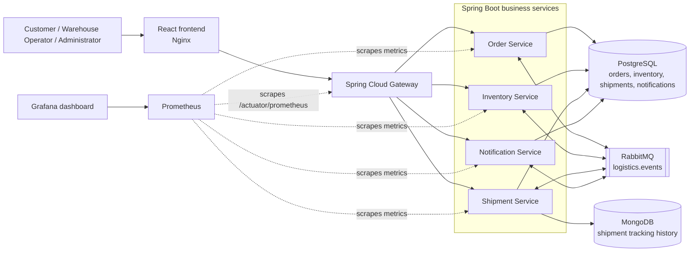

# Cloud-Native Logistics and Shipment Management Platform

## Project report

> **Report preparation note:** Replace the title-page fields below with the submitting student's and institution's details. Technical descriptions and test results in this report reflect the current repository and the local Minikube verification; do not present unimplemented or unverified capabilities as completed work.

### Title page

- **Project title:** Cloud-Native Logistics and Shipment Management Platform
- **Subject:** Cloud-Native Architecture for Modern Platforms
- **Student:** [Name]
- **Student ID:** [ID]
- **Institution / department:** [Institution]
- **Supervisor:** [Name]
- **Submission date:** [Date]

## Abstract

This project implements a local cloud-native logistics application for coordinating order creation, inventory reservation, shipment tracking, delivery, and customer notifications. A React frontend accesses four Spring Boot business services through a Spring Cloud Gateway. PostgreSQL stores transactional application data, MongoDB stores shipment tracking history, and RabbitMQ carries asynchronous workflow events. Docker packages the services and Minikube runs them as Kubernetes deployments. Prometheus collects application metrics and Grafana presents service-health dashboards.

The application was verified on a local Minikube profile with 11 deployments, an end-to-end order-to-delivery workflow, and five Prometheus scrape targets. Automated backend tests and the frontend production build passed. A bounded 25-user k6 test exposed a performance limitation: the local deployment did not meet its configured latency and failure thresholds. This report describes the implemented system and records that result as a limitation rather than claiming production-scale performance.

## 1. Introduction

Logistics workflows span several related business capabilities: receiving orders, checking and reserving stock, coordinating shipment progress, and informing users of important events. When these capabilities are tightly coupled or handled by disconnected systems, changes and failures can affect unrelated operations, and following an order across its lifecycle becomes difficult.

This project demonstrates a microservice-oriented approach. Business capabilities are split among independently deployable services, synchronous browser requests enter through a gateway, and RabbitMQ events coordinate background workflow steps. Containers and Kubernetes provide a repeatable local deployment and service discovery environment.

## 2. Problem statement

The application needs to coordinate order, inventory, shipment, and notification state while providing a visible, demonstrable workflow. A single-process or manually updated demonstration does not clearly show service boundaries, asynchronous integration, delivery progression, or operational metrics. The project provides a working local system in which these interactions can be observed through the UI, Kubernetes, and monitoring dashboard.

## 3. Objectives

- Implement a browser-based logistics operations interface.
- Provide a single API entry point using Spring Cloud Gateway.
- Separate order, inventory, shipment, and notification responsibilities into Spring Boot services.
- Coordinate order and delivery processing through RabbitMQ events.
- Persist structured business records and shipment tracking history.
- Authenticate demo users and restrict operational actions by role.
- Build and run the services as containers on a local Kubernetes cluster.
- Expose health and metrics data through Prometheus and Grafana.
- Verify the core workflow with automated tests and a live local deployment.

## 4. Scope

### Included

- Demo customer, warehouse operator, and administrator accounts.
- Order creation and retrieval.
- Inventory listing and operator stock updates.
- Inventory reservation or rejection after order creation.
- Shipment creation and timestamped tracking milestones.
- Automatic simulated shipment progression and delivery.
- In-app notifications generated from shipment events.
- Docker Compose and Kubernetes/Minikube deployment configurations.
- Prometheus metrics collection, a Grafana dashboard, and a bounded local k6 scenario.

### Not included or not established by this implementation

- Integration with real carriers, payment processors, email providers, or SMS providers.
- Production-grade multi-node high availability or autoscaling validation.
- Evidence of performance at production-scale traffic.
- A production identity provider, external secret manager, or production-ready credentials.

## 5. System architecture

The frontend is served by Nginx in its container and forwards API requests through the gateway. Kubernetes Services provide in-cluster discovery for the gateway, business services, databases, broker, and monitoring components.

### Architecture decisions

- **Microservices:** business capabilities are separate Spring Boot applications with their own HTTP endpoints and deployments.
- **Synchronous API:** the frontend uses a common gateway entry point; the gateway routes requests to the responsible service.
- **Asynchronous events:** RabbitMQ allows services to react to order and shipment events without requiring the complete workflow to run in one synchronous request.
- **Persistence:** PostgreSQL stores structured transactional records. MongoDB stores flexible shipment milestone history. The local deployment uses one PostgreSQL server/database for the application; service ownership is at the application/service level, not a claim of separate database servers.
- **Container orchestration:** Docker builds application images. Kubernetes manages pods, Services, health probes, resource requests/limits, and persistent claims. Minikube supplies the single-node local cluster.
- **Observability:** Spring Actuator exposes health and Prometheus metrics; Prometheus scrapes the gateway and four business services; Grafana reads Prometheus.

## 6. Components and responsibilities

| Component | Responsibility |
|---|---|
| React frontend | User login and operations screens for orders, inventory, shipments, and notifications; polls for updated records. |
| API Gateway | Routes API requests to backend services and validates signed JWTs. |
| Order Service | Creates and retrieves orders, records idempotency/outbox information, and processes inventory and delivery events. |
| Inventory Service | Reads and updates stock, consumes order-created events, and publishes reservation or rejection results. |
| Shipment Service | Creates shipment records, stores tracking history, simulates milestone progression, and publishes delivery events. |
| Notification Service | Consumes shipment events and stores in-app notifications. |
| PostgreSQL | Persistent structured data used by business services. |
| MongoDB | Shipment tracking history. |
| RabbitMQ | Topic exchange and queues for asynchronous logistics events. |
| Prometheus | Scrapes `/actuator/prometheus` from five application services every five seconds. |
| Grafana | Presents request rate, p95 latency, 5xx rate, and JVM heap panels in the Logistics Service Health dashboard. |

## 7. Technology stack

| Layer | Implemented technology |
|---|---|
| Frontend | React 19, JavaScript/JSX, Vite, Nginx |
| Backend | Java 21, Spring Boot 3.4.2 |
| Gateway | Spring Cloud Gateway; Spring Cloud dependency line 2024.0.0 |
| Security | Spring Security, signed JWTs, role-based access, BCrypt password hashes |
| Relational persistence | PostgreSQL 17, Spring Data JPA |
| Tracking persistence | MongoDB 8 |
| Messaging | RabbitMQ 4 management image, Spring AMQP |
| Containers | Docker |
| Orchestration | Kubernetes on Minikube |
| Monitoring | Prometheus 3.5.0 and Grafana 12.1.1 |
| Testing / load generation | Maven tests, frontend production build, k6 local scenario |

**Implementation accuracy:** The supplied draft describes React with TypeScript and several additional frontend libraries. The current repository frontend source is React JSX; this report lists only technologies confirmed in the project configuration.

## 8. Order-to-delivery workflow

1. A customer submits an order through the frontend and gateway.
2. The Order Service stores the order and publishes an `OrderCreated` event using its outbox workflow.
3. The Inventory Service consumes the event, checks stock, updates available inventory, and publishes `InventoryReserved` or `InventoryRejected`.
4. On successful reservation, the Shipment Service creates a shipment and stores tracking milestones.
5. The shipment simulator advances through `CREATED`, `PICKED_UP`, `IN_TRANSIT`, `OUT_FOR_DELIVERY`, and `DELIVERED`. The default interval is 10 seconds per transition; a complete simulated route therefore takes roughly 40 seconds after creation.
6. Delivery publishes `ShipmentDelivered`. The Order Service updates the order state, and the Notification Service records in-app notifications.
7. The frontend refreshes operational data periodically so that users can see status changes and tracking history.

RabbitMQ event delivery is treated as at-least-once; the system does not claim exactly-once processing. Idempotency protections are used for relevant repeat-processing paths.

## 9. Security and reliability

- Login issues signed JWT access tokens; the gateway and services validate token signature, issuer, audience, and expiry.
- Roles distinguish customer access from warehouse/admin operations such as stock updates and manual delivery.
- BCrypt protects the fixed local demo-account passwords.
- The order write and outbox record are transactional; publication retries are bounded, with exhausted records marked dead-letter.
- Kubernetes credentials are stored in a namespace Secret for this local deployment. Demo accounts and locally generated secret values are not production credentials.
- Health probes and persistent volume claims are configured for application and infrastructure workloads.
- Message processing is at-least-once, so duplicate handling matters; exactly-once guarantees are not claimed.

## 10. Deployment and operation

The primary demonstration deployment is a single-node Minikube cluster using the `logistics` profile. The deployment script builds/tests the backend, builds and loads container images, applies manifests, and waits for rollouts. The local deployment includes 11 workloads: frontend, gateway, four business services, three data/broker services, Prometheus, and Grafana. PostgreSQL, MongoDB, and RabbitMQ each use a persistent volume claim.

The full demonstration commands, account credentials, Grafana secret retrieval, and service routes are in [DEMO_PRESENTATION_GUIDE.md](./DEMO_PRESENTATION_GUIDE.md). Grafana's admin password is retrieved from the Kubernetes Secret at runtime rather than stored in this report.

## 11. Verification and results

### Functional and build verification

- `mvn -f backend\pom.xml clean verify`: **passed**, 9 tests, 0 failures.
- `npm run build --workspace frontend`: **passed**.
- Minikube `logistics`: all **11/11 deployments** became available.
- PostgreSQL, MongoDB, and RabbitMQ persistent volume claims: **bound**.
- Live customer login, order creation, inventory reservation, shipment creation and delivery, order status update, and notification generation: **verified**.
- Shipment simulation progressed through all five milestones and updated the order to `DELIVERED`.
- Prometheus reported all five application scrape targets `up`; Grafana health endpoint returned HTTP 200 and the Logistics Service Health dashboard was provisioned.

### Bounded load test

The local k6 scenario was executed with up to 25 virtual users for 60 seconds. It did **not** satisfy the configured targets (`p95 < 2 seconds` and less than 5% failed requests):

| Measurement | Observed result |
|---|---:|
| Request rate | 3.96 requests/second |
| HTTP request p95 latency | 9.99 seconds |
| Failed HTTP requests | 53.44% |
| Order creation | 7 successful from 8 attempts |
| Main observed failure | Login request timeouts |

After the run, all five Prometheus targets remained up, all 11 pods were ready, and a single customer login succeeded. Kubernetes Metrics API was unavailable, so `kubectl top` resource measurements could not be collected. The result indicates that this local, resource-limited configuration does not currently meet the stated performance thresholds at this load; it should not be represented as a successful capacity benchmark.

## 12. Limitations and future work

### Current limitations

- Minikube is a single-node cluster; high availability and production scaling were not tested.
- The 25-user load test exceeded latency and request-failure thresholds. Startup/login contention was prominent.
- The Kubernetes Metrics API was unavailable during validation, limiting pod-level CPU and memory analysis.
- Automated browser end-to-end testing was not run.
- Demo users, local secrets, and service configuration are for a local demonstration only.
- Real external carrier, payment, email, and SMS integrations are outside the verified implementation.

### Recommended next steps

1. Add repeatable resource monitoring (for example, Metrics Server or container-level metrics) and capture CPU/memory alongside Prometheus application metrics.
2. Profile login and gateway/service behavior under load; review database connection pools, CPU/memory limits, readiness, and resource contention.
3. Rerun staged tests at increasing concurrency after tuning, and retain exported k6 results for comparison.
4. Add browser-based end-to-end tests for login, order creation, shipment tracking, and notifications.
5. For a production-oriented extension, introduce external secret management, a real identity provider, high-availability deployment, and integration testing for carrier and notification providers.

## 13. Conclusion

The project demonstrates a complete local logistics workflow using a React interface, Spring Cloud microservices, synchronous API routing, asynchronous RabbitMQ events, relational and document persistence, and Kubernetes deployment. The verified order-to-delivery path and monitoring dashboard provide a concrete demonstration of microservice coordination. The bounded load test also surfaced a clear performance limitation, making further profiling and resource tuning necessary before claiming capacity beyond the verified local functional workload.

## Repository references

- [Technical documentation](./TECHNICAL_DOCUMENTATION.md)
- [Demo presentation guide](./DEMO_PRESENTATION_GUIDE.md)
- [Kubernetes deployment script](./scripts/deploy-kubernetes.ps1)
- [Kubernetes manifests](./infrastructure/kubernetes/)
- [Grafana dashboard definition](./infrastructure/monitoring/grafana/dashboards/logistics-overview.json)
- [k6 load test](./load-tests/orders.js)
- Supplied source document: `C:\Users\gitav\Downloads\PROJCTDOC.docx`
