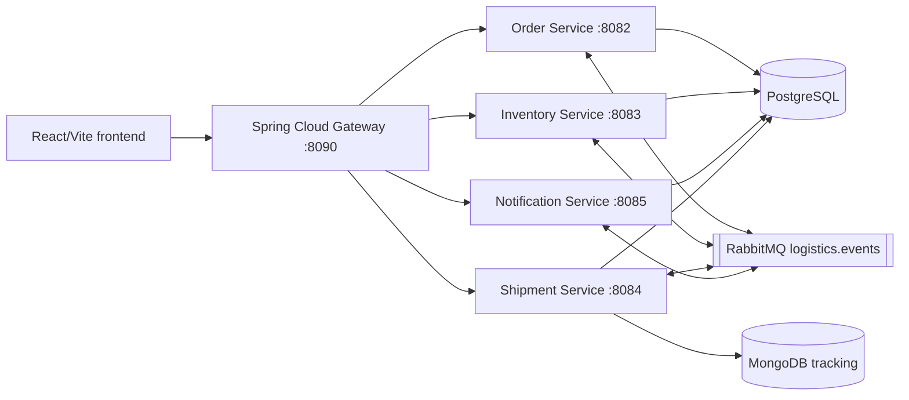

 # Technical documentation

## Architecture

The project is a Java 21 Spring Boot multi-module system with Spring Cloud Gateway and four independently deployable business services.



## Services and persistence

- `api-gateway`: routes `/api/auth`, `/api/orders`, `/api/dashboard`, `/api/inventory`, `/api/shipments`, and `/api/notifications`.
- `order-service`: JPA order records and idempotency keys in PostgreSQL; publishes `OrderCreated`; consumes inventory results and delivery events.
- `inventory-service`: JPA stock records in PostgreSQL; atomically decrements available stock and publishes `InventoryReserved` or `InventoryRejected`.
- `shipment-service`: stores current shipment state in PostgreSQL and tracking history in MongoDB; consumes `InventoryReserved` and publishes `ShipmentCreated`/`ShipmentDelivered`.
- `notification-service`: JPA in-app notifications in PostgreSQL; consumes shipment events.

The shipment service simulates a demo route from `CREATED` through `PICKED_UP`, `IN_TRANSIT`, `OUT_FOR_DELIVERY`, and `DELIVERED`, advancing one milestone every 10 seconds by default. Each tracking event includes a timestamp, location, and description. Set `SHIPMENT_SIMULATION_ENABLED=false` to disable the timed simulation; `SHIPMENT_SIMULATION_INTERVAL_MS` changes its interval. The delivery event updates the order and generates a notification.

## API

`POST /api/auth/login`, `GET|POST /api/orders`, `GET|PUT /api/inventory/:sku`, `GET /api/shipments`, `POST /api/shipments/:id/deliver`, `GET /api/notifications`, and `PATCH /api/notifications/:id/read` are implemented behind the gateway. Login returns signed JWT access tokens; the gateway and services validate token signature, issuer, audience, and expiry. Inventory edits and marking shipments delivered are restricted to warehouse operators and administrators.

The React operations console loads orders, inventory, shipments, and notifications from their owning services. It shows shipment tracking history and notification message fields from the API, and provides stock updates and delivery actions for authorized roles. Dashboard metrics are derived from those service responses.

## Events

RabbitMQ uses the durable `logistics.events` topic exchange with independent queues:

- `inventory.order-created`
- `order.inventory-results`
- `order.shipment-delivered`
- `shipment.inventory-reserved`
- `notification.shipment-events`

JSON message conversion is configured across services. Consumers use service-owned records and request idempotency to avoid duplicate order creation. Delivery is at-least-once; exactly-once delivery is not claimed.

## Deployment and monitoring

`docker compose up --build -d` starts the five Spring services, PostgreSQL, MongoDB, RabbitMQ, frontend, Prometheus, and Grafana. On Windows, `.\scripts\deploy-kubernetes.ps1` builds the images, starts the `logistics` Minikube profile, loads the images into the cluster, creates local-only credentials, and applies the manifests under `infrastructure/kubernetes`. The Kubernetes manifests include persistent volume claims for PostgreSQL, MongoDB, and RabbitMQ, plus health probes and resource requests/limits. The script stops this project's Compose containers first to leave memory for Minikube; it does not remove their data volumes. Gateway health is `/actuator/health`; all five services expose Prometheus-format metrics at `/actuator/prometheus`. Prometheus scrapes each service every five seconds, and Grafana provisions the Logistics Service Health dashboard with request rate, p95 latency, 5xx rate, and JVM heap panels.

`load-tests/orders.js` is a local-only, bounded k6 scenario: at most 25 virtual users for 60 seconds, one order creation per virtual user, plus repeated authenticated reads. Run it from PowerShell with `.\load-tests\run-local-load-test.ps1 -BaseUrl <the-local-frontend-url>`. It rejects non-loopback hosts and reports request-failure/latency thresholds. Load tests add up to 25 demo orders to the database.

To access Kubernetes services locally, run the following in separate PowerShell windows:

```powershell
kubectl port-forward -n logistics svc/frontend 5173:80
kubectl port-forward -n logistics svc/api-gateway 8090:8080
kubectl port-forward -n logistics svc/prometheus 9090:9090
kubectl port-forward -n logistics svc/grafana 3000:3000
```

## Security limitations

The deployment script generates local Kubernetes credentials and stores them in the namespace Secret `logistics-secrets`. The demo user accounts and default JWT issuer/audience are for local testing only. Do not copy these settings or demo credentials to a production deployment.
## Reliability and security hardening

JWT signing configuration is provided to the gateway and services through Kubernetes Secrets. Access tokens are validated for signature, issuer, audience, and expiry; BCrypt protects the fixed development-user passwords. The order write and `OrderCreated` outbox row share one transaction. The publisher retries pending rows with bounded exponential delay and records exhausted rows as `DEAD_LETTER`. Delivery remains at-least-once; consumers must remain idempotent and exactly-once delivery is not claimed.
